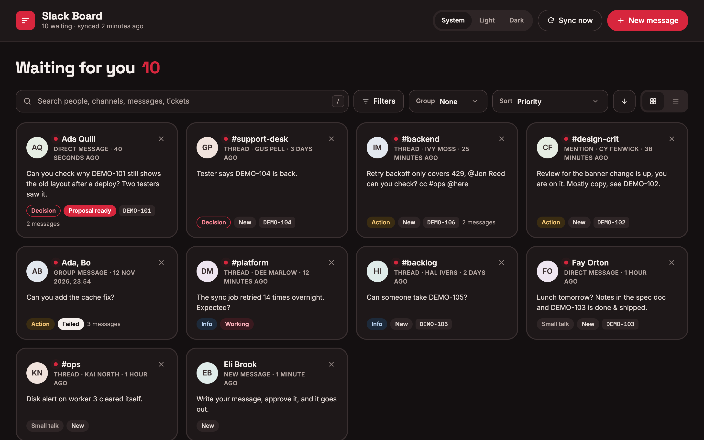
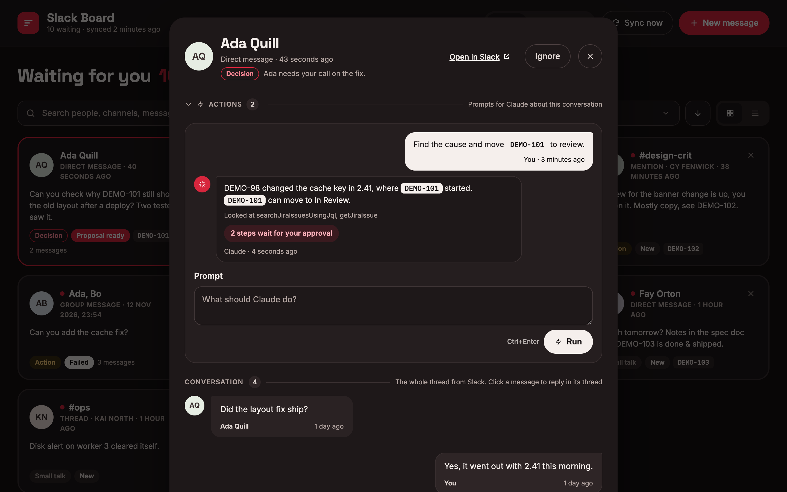

# Slack Board

Every Slack message waiting for you, on one board in Claude Code. Write a rough note in any language, Claude turns it into a reply in your voice, and nothing reaches Slack or Jira until you approve it.



## A morning with the board

You open Claude Code and run `/board`. Eight conversations are waiting. The two marked Decision are at the top: someone needs your call on a fix, someone asks whether a release goes out today.

You open the first card. The conversation is there, with the ticket it mentions: status, assignee, priority. You write a quick note in your own language, as rough as you like: got it, it's fixed, move it to review. A moment later Claude proposes a reply in the conversation's language and in your style, a status change for the ticket and a reaction. You fix one word in the reply and press Approve and send. The card leaves the board.

Prefer your own words? Turn off polishing in the settings and your reply goes out exactly as you wrote it.

The small talk at the bottom can wait until lunch.



## What it does

- Collects DMs, group DMs, @mentions and replies in your threads every 5 minutes while Claude Code is open. One conversation is one card; answer it in Slack and the card goes away.
- Ranks cards by what they need from you: Decision, Action, Info or Small talk.
- Shows status, assignee and priority of every Jira ticket a message mentions. Claude summarises a ticket only when you ask.
- Shows the whole conversation from Slack, your own messages included, and marks where the messages waiting for you start.
- Drafts replies, reactions and Jira steps (comment, status, assignee, fields) from your note. You edit and approve; nothing is sent before that. Send as written and the reaction buttons go out at once, without Claude.
- Runs prompts about a conversation in Actions the way Claude Code does: Claude looks things up with your claude.ai connectors, answers on the card, and proposes any change as steps you approve.
- Replies in the thread of any message you click and starts new messages to people or channels.
- Typo-tolerant search across people, channels, messages and tickets, filters, grouping into sections, tiles or list, light and dark theme.
- Mentions show as names; click one to start a message to that person.

## Requirements

- Claude Code signed in with a claude.ai account, with the Slack connector connected on claude.ai (Settings, Connectors). Connect Atlassian too if you want the Jira features. The board uses only claude.ai connectors, never a local MCP server.
- Node.js 24 or newer on your `PATH`. The board needs no `npm install`.

## Install

Add the construct marketplace and install the plugin from it:

```bash
claude plugin marketplace add d2a8k3u/construct
```

```bash
claude plugin install slack-board@construct
```

Restart Claude Code, then run `/board` in any session. The board opens in your browser and fills after the first sync, about 5 seconds after Claude Code starts.

To use Jira, set `jira_site` (for example `yourteam.atlassian.net`) and `jira_projects` (for example `PROJ,OPS`) in the plugin settings. All settings are in [docs/settings.md](docs/settings.md).

## Learn more

- [Use the board](docs/usage.md): conversations, replies, threads, prompts, tickets, new messages.
- [Settings](docs/settings.md): every option with its default.
- [How it works](docs/how-it-works.md): what runs where, what Claude is asked, what is stored, and the security model.
- [Contributing](CONTRIBUTING.md): set up, checks and code style.

## License

MIT, see [LICENSE](LICENSE).
